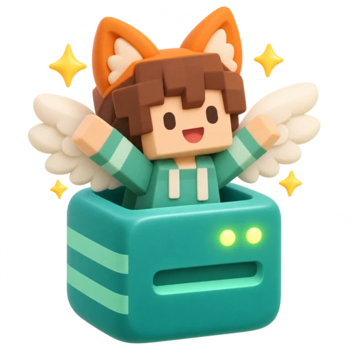
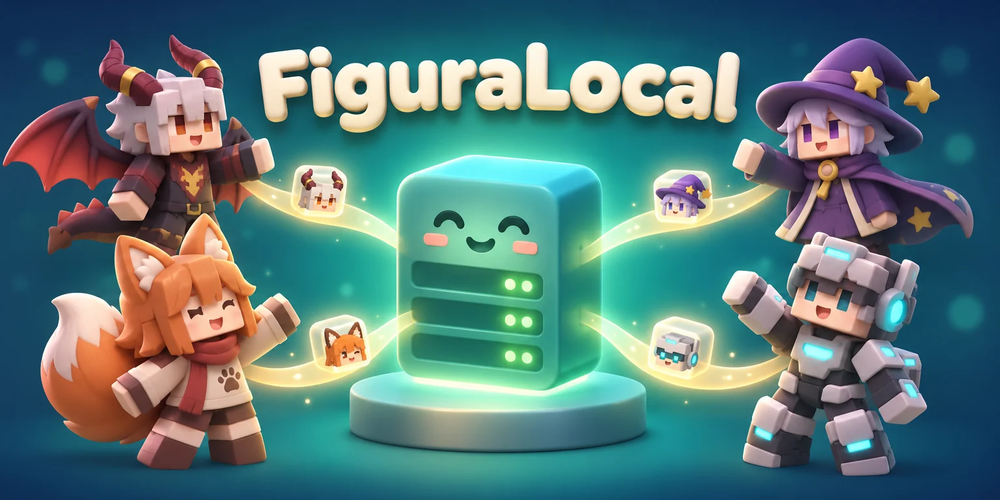
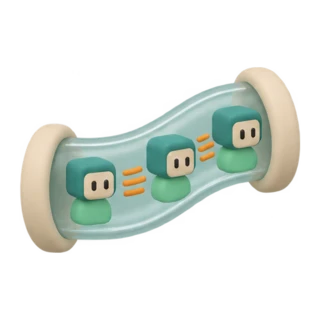
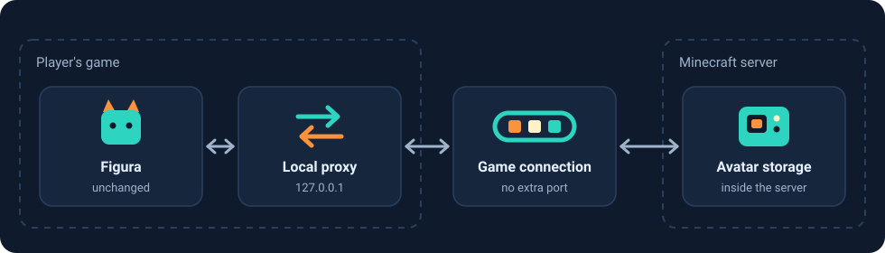

<h1 align="center">
  <br>
  FiguraLocal
</h1>

<p align="center">
  Let your Minecraft server store and share <a href="https://github.com/FiguraMC/Figura">Figura</a> avatars by itself.
</p>

<p align="center">
  <a href="https://github.com/artmasster/FiguraLocal/releases/latest"></a>
</p>

<p align="center">
  
  
  
  
  <a href="https://mcsv.me"></a>
</p>

<p align="center">
  <b>English</b> · <a href="docs/README.th.md">ไทย</a> · <a href="docs/README.zh-CN.md">简体中文</a> · <a href="docs/README.ja.md">日本語</a>
</p>

<p align="center">
  
</p>

Figura normally uploads avatars to its central cloud, which limits each avatar to 100 KiB.
With FiguraLocal the Minecraft server keeps the avatars, so the server owner decides the limit.

<table>
  <tr>
    <td align="center" width="33%">
      <br>
      <b>No extra port</b><br>
      Avatar data travels over the normal game connection.
    </td>
    <td align="center" width="33%">
      <br>
      <b>No external program</b><br>
      Everything is plain Java inside the mod. No Node.js, no web server.
    </td>
    <td align="center" width="33%">
      <br>
      <b>No setup</b><br>
      Drop the jar in <code>mods</code> on the server and on each player's game. That's it.
    </td>
  </tr>
</table>

> Status: early release. The backend is covered by automated tests, and Figura 0.1.5 in a real
> Forge client has logged in and connected to it through a Forge server. Sharing avatars between
> several real players has not been tested in game yet. Please report problems.

## Download

**[Download the latest jar from the Releases page](https://github.com/artmasster/FiguraLocal/releases/latest)**

The same jar goes on the server and on each player's game.

## Install

| Where | What to put in `mods` |
|---|---|
| Server (Forge 1.20.1) | `figuralocal-forge-<version>.jar` |
| Each player (Forge 1.20.1) | `figuralocal-forge-<version>.jar` and Figura 0.1.5 or newer |

The server does not need Figura. Players without FiguraLocal can still join; they keep using the
Figura cloud and will not see avatars stored on the server.

When a player with FiguraLocal joins, Figura reconnects to the server's own avatar storage on its
own, and switches back to the Figura cloud after leaving. Upload avatars from the Figura wardrobe as
usual.

## Settings

The server creates `config/figuralocal.properties` on first start.

| Setting | Default | Meaning |
|---|---|---|
| `enabled` | `true` | Set to `false` to switch FiguraLocal off without removing the jar |
| `maxAvatarSizeKb` | `5120` | Largest avatar a player may upload, in KiB |
| `pingSize` | `1024` | Largest ping payload in bytes |
| `pingRate` | `32` | Pings a player may send per second |
| `windowKb` | `128` | KiB in flight per transfer; lower it if players on slow links lag during uploads |
| `motd` | empty | Message shown in Figura's backend status |

Avatars are saved in `figuralocal/avatars/<player uuid>.moon` in the server folder, one per player.
Deleting a file removes that player's avatar.

## Good to know

- Figura only loads avatars for regular Minecraft accounts, so this works on online-mode servers.
  That is Figura's own rule and FiguraLocal does not change it.
- An avatar stored on one server is not visible on other servers or on the Figura cloud.
- A large avatar is downloaded by every player who sees it. Keep `maxAvatarSizeKb` sensible for your
  players' connections.
- Only the player an avatar belongs to can upload or delete it. The server identifies players by
  their game connection, so no account details leave the server.

## How it works

<p align="center">
  
</p>

1. When a player joins, the server sends a hello packet on its own channel.
2. The player's game opens a proxy on a loopback port and tells Figura to use it as its backend.
3. Figura's normal HTTP and WebSocket traffic enters the proxy, is cut into packets and travels over
   the game connection. A send window keeps a big transfer from holding up game packets.
4. On the server a small HTTP and WebSocket implementation answers the same calls as the Figura
   cloud: login, upload, download, delete, pings and reload events.

FiguraLocal changes Figura in two places only: the two methods that return the backend address.
It does not contain any Figura code.

## Build

Java 17 or newer is needed to run Gradle; it downloads the rest.

```
./gradlew build
```

The jar is written to `build/libs`. `./gradlew test` runs the backend tests, which drive the server
and player sides through an in-memory connection with the same HTTP and WebSocket clients Figura uses.

To try it with Figura in a development client:

```
./gradlew runServer
./gradlew runClient -PwithFigura -PjoinServer=127.0.0.1:25565
```

## Made by MCSV

<table>
  <tr>
    <td width="96" align="center"><a href="https://mcsv.me"></a></td>
    <td>
      FiguraLocal is built and maintained by <a href="https://mcsv.me"><b>MCSV</b></a>, a Minecraft server host based in Thailand.<br>
      Need a Forge server to try it on? One is ready in about 30 seconds and billed by the day.
    </td>
  </tr>
</table>

## License

MIT. FiguraLocal is an independent project and is not affiliated with or endorsed by the Figura team.
