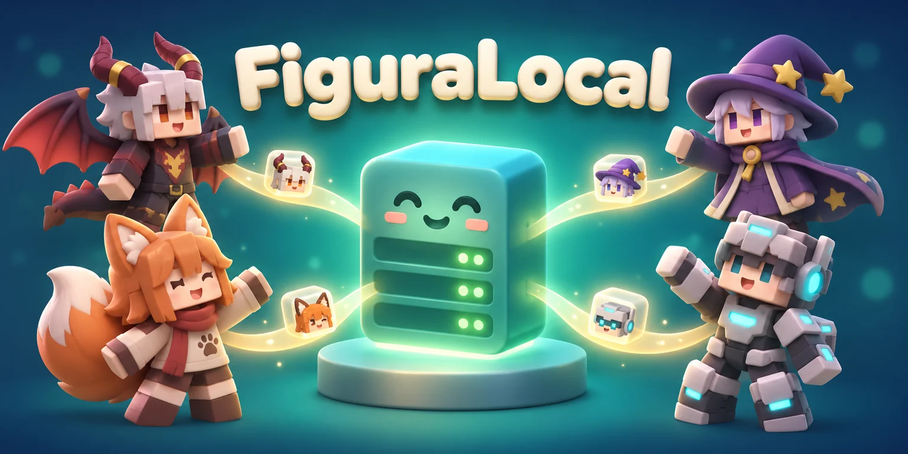
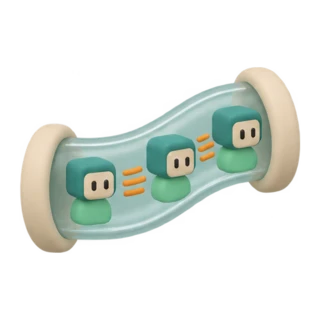
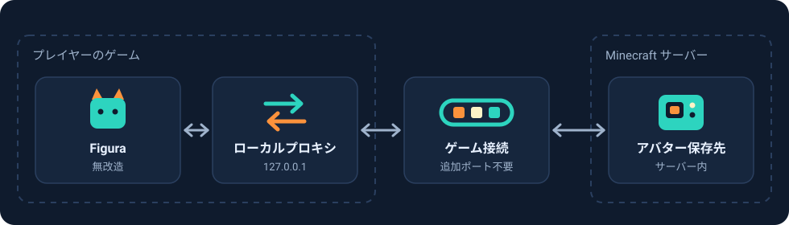

<h1 align="center">
  <br>
  FiguraLocal
</h1>

<p align="center">
  Minecraft サーバー自身が <a href="https://github.com/FiguraMC/Figura">Figura</a> のアバターを保存して共有できるようにします。
</p>

<p align="center">
  <a href="https://github.com/artmasster/FiguraLocal/releases/latest"></a>
</p>

<p align="center">
  
  
  
  
</p>

<p align="center">
  <a href="../README.md">English</a> · <a href="README.th.md">ไทย</a> · <a href="README.zh-CN.md">简体中文</a> · <b>日本語</b>
</p>

<p align="center">
  
</p>

Figura は通常、アバターを公式クラウドにアップロードします。公式クラウドではアバター 1 つにつき 100 KiB までです。
FiguraLocal を使うと Minecraft サーバーがアバターを保存するので、上限はサーバー管理者が決められます。

<table>
  <tr>
    <td align="center" width="33%">
      <br>
      <b>追加のポートは不要</b><br>
      アバターのデータは通常のゲーム接続を通ります。
    </td>
    <td align="center" width="33%">
      <br>
      <b>外部プログラムは不要</b><br>
      すべて Mod 内の Java だけで動きます。Node.js も Web サーバーも使いません。
    </td>
    <td align="center" width="33%">
      <br>
      <b>設定は不要</b><br>
      サーバーと各プレイヤーの <code>mods</code> フォルダーに jar を入れるだけです。
    </td>
  </tr>
</table>

> 状況：初期リリースです。バックエンドには自動テストがあり、実際の Forge クライアント上の
> Figura 0.1.5 が Forge サーバー経由でログインして接続できることを確認しています。
> 複数の実プレイヤー間でのアバター共有は、まだゲーム内でテストしていません。問題があれば報告してください。

## ダウンロード

**[Releases ページから最新の jar をダウンロード](https://github.com/artmasster/FiguraLocal/releases/latest)**

サーバーと各プレイヤーで同じ jar を使います。

## インストール

| 場所 | `mods` に入れるもの |
|---|---|
| サーバー（Forge 1.20.1） | `figuralocal-forge-<version>.jar` |
| 各プレイヤー（Forge 1.20.1） | `figuralocal-forge-<version>.jar` と Figura 0.1.5 以降 |

サーバーに Figura は必要ありません。FiguraLocal を入れていないプレイヤーも参加できますが、
引き続き Figura の公式クラウドを使うため、サーバーに保存されたアバターは見えません。

FiguraLocal を入れたプレイヤーが参加すると、Figura は自動的にサーバー側のアバター保存先に切り替わり、
退出すると公式クラウドに戻ります。アバターのアップロードは、これまでどおり Figura のワードローブ画面から行います。

## 設定

サーバーは初回起動時に `config/figuralocal.properties` を作成します。

| 設定 | 既定値 | 意味 |
|---|---|---|
| `enabled` | `true` | `false` にすると jar を削除せずに FiguraLocal を無効にできます |
| `maxAvatarSizeKb` | `5120` | プレイヤーがアップロードできるアバターの最大サイズ（KiB） |
| `pingSize` | `1024` | ping データの最大サイズ（バイト） |
| `pingRate` | `32` | プレイヤーが 1 秒間に送信できる ping の数 |
| `windowKb` | `128` | 1 回の転送で送信中にできる量（KiB）。回線の遅いプレイヤーがアップロード中に重くなる場合は下げてください |
| `motd` | 空 | Figura のバックエンド状態に表示されるメッセージ |

アバターはサーバーフォルダーの `figuralocal/avatars/<プレイヤーの uuid>.moon` に、プレイヤーごとに 1 つ保存されます。
ファイルを削除すると、そのプレイヤーのアバターが削除されます。

## 知っておくこと

- Figura は正規の Minecraft アカウントのアバターだけを読み込むため、online-mode のサーバーで動作します。
  これは Figura 自体の仕様で、FiguraLocal は変更していません。
- あるサーバーに保存されたアバターは、ほかのサーバーや Figura の公式クラウドでは見えません。
- 大きなアバターは、それを見るすべてのプレイヤーがダウンロードします。
  プレイヤーの回線に合わせて `maxAvatarSizeKb` を設定してください。
- アバターをアップロードまたは削除できるのは持ち主だけです。サーバーはゲーム接続でプレイヤーを
  識別するため、アカウント情報がサーバーの外に出ることはありません。

## 仕組み

<p align="center">
  
</p>

1. プレイヤーが参加すると、サーバーは Mod 専用のチャンネルで hello パケットを送ります。
2. プレイヤーのゲームはループバックのポートでプロキシを開き、Figura にそれをバックエンドとして使わせます。
3. Figura の通常の HTTP と WebSocket の通信はプロキシに入り、パケットに分割されてゲーム接続を通ります。
   送信ウィンドウにより、大きな転送がゲーム本来のパケットを妨げないようにしています。
4. サーバー側では小さな HTTP と WebSocket の実装が、Figura の公式クラウドと同じ呼び出しに応答します。
   ログイン、アップロード、ダウンロード、削除、ping、再読み込みの通知です。

FiguraLocal が Figura に手を加えるのは 2 か所だけです。バックエンドのアドレスを返す 2 つのメソッドです。
Figura のコードは一切含んでいません。

## ビルド

Gradle の実行には Java 17 以降が必要です。残りは Gradle がダウンロードします。

```
./gradlew build
```

jar は `build/libs` に出力されます。`./gradlew test` はバックエンドのテストを実行します。サーバー側と
プレイヤー側をメモリ内の接続でつなぎ、Figura と同じ HTTP と WebSocket のクライアントで動かします。

開発用クライアントで Figura と一緒に試すには：

```
./gradlew runServer
./gradlew runClient -PwithFigura -PjoinServer=127.0.0.1:25565
```

## ライセンス

MIT。FiguraLocal は独立したプロジェクトであり、Figura チームとの関係や公認はありません。
