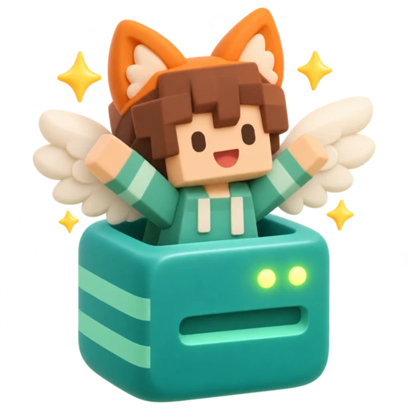
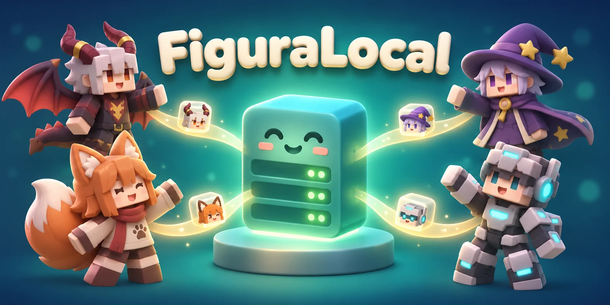
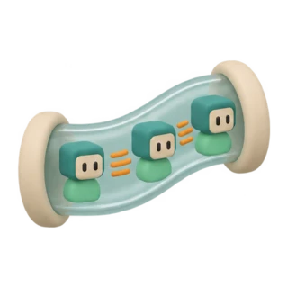
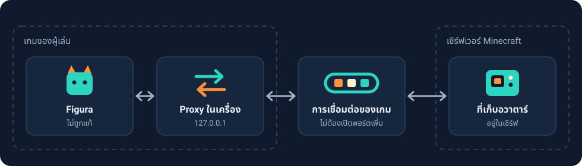

<h1 align="center">
  <br>
  FiguraLocal
</h1>

<p align="center">
  ให้เซิร์ฟเวอร์ Minecraft ของคุณเก็บและแชร์อวาตาร์ <a href="https://github.com/FiguraMC/Figura">Figura</a> ได้เอง
</p>

<p align="center">
  <a href="https://github.com/artmasster/FiguraLocal/releases/latest"></a>
</p>

<p align="center">
  
  
  
  
</p>

<p align="center">
  <a href="../README.md">English</a> · <b>ไทย</b> · <a href="README.zh-CN.md">简体中文</a> · <a href="README.ja.md">日本語</a>
</p>

<p align="center">
  
</p>

ปกติ Figura จะอัปโหลดอวาตาร์ขึ้นคลาวด์กลาง ซึ่งจำกัดขนาดอวาตาร์ไว้ที่ 100 KiB
เมื่อใช้ FiguraLocal เซิร์ฟเวอร์ Minecraft จะเป็นคนเก็บอวาตาร์เอง เจ้าของเซิร์ฟจึงกำหนดขนาดสูงสุดได้เอง

<table>
  <tr>
    <td align="center" width="33%">
      <br>
      <b>ไม่ต้องเปิดพอร์ตเพิ่ม</b><br>
      ข้อมูลอวาตาร์วิ่งผ่านการเชื่อมต่อของเกมตามปกติ
    </td>
    <td align="center" width="33%">
      <br>
      <b>ไม่ต้องลงโปรแกรมอื่น</b><br>
      ทุกอย่างเป็น Java อยู่ในม็อด ไม่มี Node.js ไม่มีเว็บเซิร์ฟเวอร์
    </td>
    <td align="center" width="33%">
      <br>
      <b>ไม่ต้องตั้งค่า</b><br>
      วางไฟล์ jar ในโฟลเดอร์ <code>mods</code> ของเซิร์ฟและของผู้เล่นแต่ละคน แค่นั้น
    </td>
  </tr>
</table>

> สถานะ: รุ่นแรก ส่วน backend มีชุดทดสอบอัตโนมัติ และ Figura 0.1.5 ใน client Forge จริง
> ล็อกอินและเชื่อมต่อกับ backend ผ่านเซิร์ฟ Forge ได้แล้ว แต่ยังไม่ได้ทดสอบการแชร์อวาตาร์
> ระหว่างผู้เล่นจริงหลายคนในเกม ถ้าเจอปัญหาช่วยแจ้งด้วยครับ

## ดาวน์โหลด

**[ดาวน์โหลดไฟล์ jar รุ่นล่าสุดจากหน้า Releases](https://github.com/artmasster/FiguraLocal/releases/latest)**

ใช้ไฟล์ jar ตัวเดียวกันทั้งฝั่งเซิร์ฟและฝั่งผู้เล่น

## ติดตั้ง

| ที่ไหน | ใส่อะไรใน `mods` |
|---|---|
| เซิร์ฟเวอร์ (Forge 1.20.1) | `figuralocal-forge-<version>.jar` |
| ผู้เล่นแต่ละคน (Forge 1.20.1) | `figuralocal-forge-<version>.jar` และ Figura 0.1.5 ขึ้นไป |

เซิร์ฟเวอร์ไม่ต้องลง Figura ผู้เล่นที่ไม่มี FiguraLocal ยังเข้าเซิร์ฟได้ตามปกติ
แต่จะใช้คลาวด์ของ Figura ต่อไป และจะไม่เห็นอวาตาร์ที่เก็บอยู่บนเซิร์ฟ

เมื่อผู้เล่นที่มี FiguraLocal เข้าเซิร์ฟ Figura จะสลับมาใช้ที่เก็บอวาตาร์ของเซิร์ฟเอง
และสลับกลับไปใช้คลาวด์ของ Figura เมื่อออกจากเซิร์ฟ การอัปโหลดอวาตาร์ทำจากหน้า wardrobe ของ Figura เหมือนเดิม

## การตั้งค่า

เซิร์ฟเวอร์จะสร้างไฟล์ `config/figuralocal.properties` ให้ตอนเปิดครั้งแรก

| ค่า | ค่าเริ่มต้น | ความหมาย |
|---|---|---|
| `enabled` | `true` | ตั้งเป็น `false` เพื่อปิด FiguraLocal โดยไม่ต้องลบไฟล์ jar |
| `maxAvatarSizeKb` | `5120` | ขนาดอวาตาร์ใหญ่สุดที่ผู้เล่นอัปโหลดได้ หน่วยเป็น KiB |
| `pingSize` | `1024` | ขนาดข้อมูล ping ใหญ่สุด หน่วยเป็นไบต์ |
| `pingRate` | `32` | จำนวน ping ที่ผู้เล่นส่งได้ต่อวินาที |
| `windowKb` | `128` | จำนวน KiB ที่ส่งค้างได้ต่อการรับส่งหนึ่งครั้ง ลดค่านี้ถ้าผู้เล่นเน็ตช้าแล็กตอนอัปโหลด |
| `motd` | ว่าง | ข้อความที่แสดงในหน้าสถานะ backend ของ Figura |

อวาตาร์ถูกเก็บที่ `figuralocal/avatars/<uuid ของผู้เล่น>.moon` ในโฟลเดอร์ของเซิร์ฟ คนละหนึ่งไฟล์
ลบไฟล์ใดก็เท่ากับลบอวาตาร์ของผู้เล่นคนนั้น

## ควรรู้

- Figura โหลดอวาตาร์ให้เฉพาะบัญชี Minecraft แท้ จึงใช้ได้กับเซิร์ฟ online-mode
  ข้อนี้เป็นกติกาของ Figura เอง FiguraLocal ไม่ได้เปลี่ยน
- อวาตาร์ที่เก็บบนเซิร์ฟหนึ่งจะไม่เห็นบนเซิร์ฟอื่น และไม่เห็นบนคลาวด์ของ Figura
- อวาตาร์ขนาดใหญ่จะถูกดาวน์โหลดโดยผู้เล่นทุกคนที่มองเห็น ควรตั้ง `maxAvatarSizeKb`
  ให้เหมาะกับความเร็วเน็ตของผู้เล่น
- มีแต่เจ้าของอวาตาร์เท่านั้นที่อัปโหลดหรือลบอวาตาร์ของตัวเองได้ เซิร์ฟรู้ว่าใครเป็นใคร
  จากการเชื่อมต่อของเกม จึงไม่มีข้อมูลบัญชีออกไปนอกเซิร์ฟ

## ทำงานอย่างไร

<p align="center">
  
</p>

1. เมื่อผู้เล่นเข้าเซิร์ฟ เซิร์ฟจะส่งแพ็กเก็ตทักทายผ่านช่องทางของม็อดเอง
2. เกมของผู้เล่นเปิด proxy ที่พอร์ต loopback แล้วบอกให้ Figura ใช้เป็น backend
3. ข้อมูล HTTP และ WebSocket ตามปกติของ Figura เข้า proxy ถูกตัดเป็นแพ็กเก็ต
   แล้วส่งผ่านการเชื่อมต่อของเกม โดยมีการจำกัดปริมาณที่ส่งค้าง เพื่อไม่ให้การรับส่งไฟล์ใหญ่ไปขวางแพ็กเก็ตของเกม
4. ฝั่งเซิร์ฟมีตัวรับ HTTP และ WebSocket ขนาดเล็กที่ตอบคำขอแบบเดียวกับคลาวด์ของ Figura
   ได้แก่ ล็อกอิน อัปโหลด ดาวน์โหลด ลบ ping และการแจ้งให้โหลดอวาตาร์ใหม่

FiguraLocal แก้ Figura แค่สองจุด คือสองฟังก์ชันที่คืนค่าที่อยู่ของ backend
และไม่มีโค้ดของ Figura อยู่ในม็อดนี้

## Build

ต้องมี Java 17 ขึ้นไปเพื่อรัน Gradle ส่วนที่เหลือ Gradle จะดาวน์โหลดให้เอง

```
./gradlew build
```

ไฟล์ jar จะอยู่ที่ `build/libs` คำสั่ง `./gradlew test` จะรันชุดทดสอบ backend ซึ่งจำลองฝั่งเซิร์ฟ
และฝั่งผู้เล่นผ่านการเชื่อมต่อในหน่วยความจำ ด้วยไลบรารี HTTP และ WebSocket ตัวเดียวกับที่ Figura ใช้

ลองใช้คู่กับ Figura ใน client สำหรับพัฒนา:

```
./gradlew runServer
./gradlew runClient -PwithFigura -PjoinServer=127.0.0.1:25565
```

## สัญญาอนุญาต

MIT FiguraLocal เป็นโปรเจกต์อิสระ ไม่ได้เกี่ยวข้องกับทีม Figura และไม่ได้รับการรับรองจากทีม Figura
