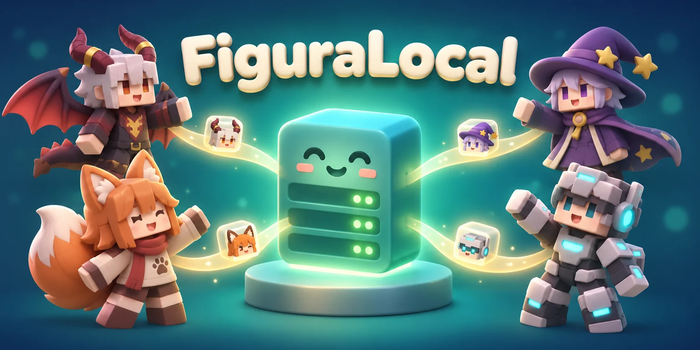
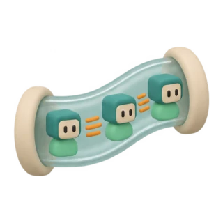
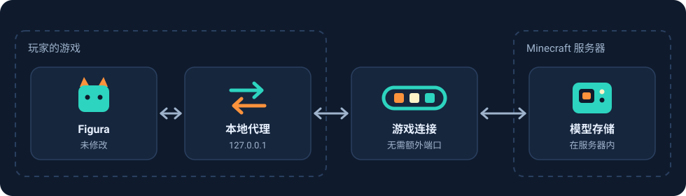

<h1 align="center">
  <br>
  FiguraLocal
</h1>

<p align="center">
  让你的 Minecraft 服务器自己保存并分享 <a href="https://github.com/FiguraMC/Figura">Figura</a> 模型。
</p>

<p align="center">
  <a href="https://github.com/artmasster/FiguraLocal/releases/latest"></a>
</p>

<p align="center">
  
  
  
  
  <a href="https://mcsv.me"></a>
</p>

<p align="center">
  <a href="../README.md">English</a> · <a href="README.th.md">ไทย</a> · <b>简体中文</b> · <a href="README.ja.md">日本語</a>
</p>

<p align="center">
  
</p>

Figura 通常会把模型（avatar）上传到官方云端，每个模型最大只能 100 KiB。
使用 FiguraLocal 后，模型由 Minecraft 服务器自己保存，大小上限由服主决定。

<table>
  <tr>
    <td align="center" width="33%">
      <br>
      <b>不需要额外端口</b><br>
      模型数据通过正常的游戏连接传输。
    </td>
    <td align="center" width="33%">
      <br>
      <b>不需要外部程序</b><br>
      全部是模组内的纯 Java 代码，没有 Node.js，也没有网页服务器。
    </td>
    <td align="center" width="33%">
      <br>
      <b>不需要配置</b><br>
      把 jar 放进服务器和每位玩家的 <code>mods</code> 文件夹即可。
    </td>
  </tr>
</table>

> 状态：早期版本。后端有自动化测试；真实 Forge 客户端中的 Figura 0.1.5 已经可以通过 Forge
> 服务器登录并连接到后端。多名真实玩家之间在游戏内分享模型尚未测试。遇到问题请反馈。

## 下载

**[在 Releases 页面下载最新的 jar](https://github.com/artmasster/FiguraLocal/releases/latest)**

服务器和每位玩家使用同一个 jar。

## 安装

| 位置 | 放进 `mods` 的文件 |
|---|---|
| 服务器（Forge 1.20.1） | `figuralocal-forge-<version>.jar` |
| 每位玩家（Forge 1.20.1） | `figuralocal-forge-<version>.jar` 和 Figura 0.1.5 或更高版本 |

服务器不需要安装 Figura。没有安装 FiguraLocal 的玩家仍然可以进入服务器，
他们会继续使用 Figura 官方云端，看不到保存在服务器上的模型。

安装了 FiguraLocal 的玩家进入服务器后，Figura 会自动改用服务器自己的模型存储，
离开后自动切换回 Figura 官方云端。上传模型的方式不变，仍然在 Figura 的衣柜界面操作。

## 设置

服务器第一次启动时会生成 `config/figuralocal.properties`。

| 设置 | 默认值 | 含义 |
|---|---|---|
| `enabled` | `true` | 设为 `false` 可以在不删除 jar 的情况下关闭 FiguraLocal |
| `maxAvatarSizeKb` | `5120` | 玩家可以上传的最大模型大小，单位 KiB |
| `pingSize` | `1024` | ping 数据的最大长度，单位字节 |
| `pingRate` | `32` | 每位玩家每秒可以发送的 ping 数量 |
| `windowKb` | `128` | 每次传输中允许在途的数据量，单位 KiB；网络较慢的玩家上传时卡顿可以调低 |
| `motd` | 空 | 显示在 Figura 后端状态中的消息 |

模型保存在服务器文件夹下的 `figuralocal/avatars/<玩家 uuid>.moon`，每位玩家一个文件。
删除文件即删除该玩家的模型。

## 须知

- Figura 只为正版 Minecraft 账号加载模型，所以本模组适用于正版验证（online-mode）服务器。
  这是 Figura 自身的规则，FiguraLocal 没有改变它。
- 保存在某个服务器上的模型，在其他服务器和 Figura 官方云端上都看不到。
- 每个能看到大模型的玩家都要下载它。请根据玩家的网络情况合理设置 `maxAvatarSizeKb`。
- 只有模型的主人可以上传或删除自己的模型。服务器通过游戏连接识别玩家，
  因此不会有账号信息离开服务器。

## 工作原理

<p align="center">
  
</p>

1. 玩家进入服务器时，服务器通过模组自己的频道发送一个问候数据包。
2. 玩家的游戏在本机回环端口上打开一个代理，并让 Figura 把它当作后端。
3. Figura 正常的 HTTP 和 WebSocket 流量进入代理，被切成数据包后通过游戏连接传输。
   发送窗口可以避免大文件传输阻塞游戏本身的数据包。
4. 服务器端有一个小型的 HTTP 和 WebSocket 实现，响应与 Figura 官方云端相同的请求：
   登录、上传、下载、删除、ping 以及重新加载通知。

FiguraLocal 只修改了 Figura 的两处：返回后端地址的两个方法。本模组不包含任何 Figura 代码。

## 构建

运行 Gradle 需要 Java 17 或更高版本，其余内容由 Gradle 自动下载。

```
./gradlew build
```

jar 会输出到 `build/libs`。`./gradlew test` 运行后端测试：在内存连接上同时运行服务器端和玩家端，
并使用与 Figura 相同的 HTTP 和 WebSocket 客户端。

在开发客户端中与 Figura 一起试用：

```
./gradlew runServer
./gradlew runClient -PwithFigura -PjoinServer=127.0.0.1:25565
```

## 由 MCSV 制作

<table>
  <tr>
    <td width="96" align="center"><a href="https://mcsv.me"></a></td>
    <td>
      FiguraLocal 由 <a href="https://mcsv.me"><b>MCSV</b></a> 开发和维护。MCSV 是一家位于泰国的 Minecraft 服务器托管商。<br>
      想找一台 Forge 服务器来试用？大约 30 秒即可开好，按天计费。
    </td>
  </tr>
</table>

## 许可证

MIT。FiguraLocal 是独立项目，与 Figura 团队没有关联，也未获得其认可。
